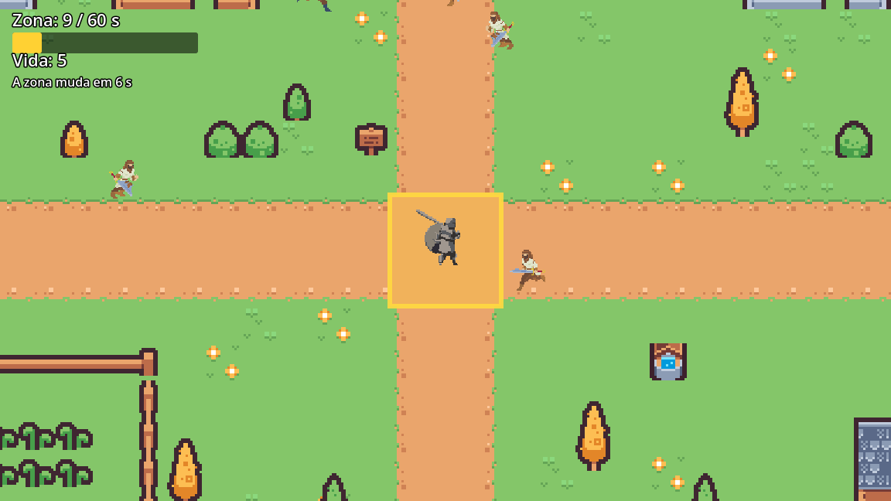

# Mercado dos Encapuzados

Jogo do projeto de Jogos Digitais II (2º bimestre 2026/2) — Matheus De Farias Lampugnani, RA 802.539.

## A carta

| Parte da carta | O que saiu |
|---|---|
| Tema | Mercado medieval com ladrões encapuzados |
| Tipo de jogo | Território — vence ao somar 60 segundos dentro de uma zona que muda de lugar; perde quando a vida acaba |
| Modo | Horda (arena vista de cima, quatro direções) |

## Como jogar

- Setas ou WASD: andar nas quatro direções.
- Espaço ou J: golpe de lança na direção em que o cavaleiro está olhando.
- Fique dentro da zona amarela para somar tempo. Com 60 segundos você vence. A zona muda de lugar a cada 15 segundos e a seta amarela aponta para ela.
- Os ladrões entram por qualquer ponto do muro e vão para a zona. Se você chegar perto, eles correm atrás de você. Encostar tira 1 de vida. Você tem 5, e se a vida acabar você perde.
- O ladrão leve cai com 1 golpe. O pesado é mais lento e aguenta 2.
- R: jogar de novo depois da vitória ou da derrota.

## Créditos

- Tileset: Tiny Town, de Kenney -- https://kenney.nl/assets/tiny-town -- licença CC0
- Personagem da Aula 08: Prof. Ezefferth, para a Aula 08 de Jogos Digitais II
- Cavaleiro (`sprites/knight-Sheet_whitefx.png`): 64x64 2D Dark Fantasy Pixel Knight, de Maxime Nourry -- https://maxime-nourry.itch.io/64x64-pixel-knight -- a página não informa a licença
- Ladrões (`sprites/ladroes/`): Bandits, de Sven Thole -- https://sventhole.itch.io/bandits -- pode ser usado em qualquer jogo, comercial ou não; só não pode ser revendido como asset
